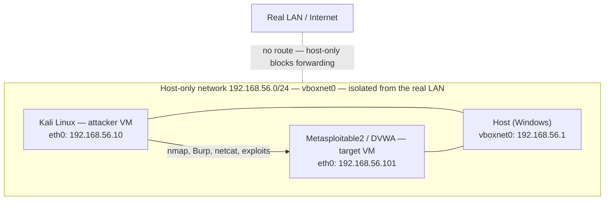

# Lab Setup Report — Task 1

ApexPlanet Cybersecurity & Ethical Hacking internship, Task 1 deliverable:
"Lab Setup Report (screenshots of Kali, Metasploitable, Wireshark test
capture)".

---

## Objective

The brief asks for a virtualised attack-lab:

- **Attacker machine:** Kali Linux with Nmap, Burp Suite, Netcat, Wireshark.
- **Target:** Metasploitable2 or DVWA — deliberately vulnerable, isolated.
- **Network:** a Host-Only Adapter between host and VMs (192.168.56.0/24),
  so the attack traffic never touches the real LAN.
- **Evidence:** screenshots of both VMs, a Wireshark test capture taken on the
  lab network, and scanner output against the target.

This report states, in order: what was attempted, the precise blocker, what
screenshots would be captured once the blocker is lifted (and why none are
presented now), what was built instead in this repository, verification of
what actually ran here, and the handover steps to finish the original lab.

---

## Attempted setup and the blocker

The lab cannot be built on this machine. Each blocker below was checked
directly; the observed facts are listed with the command that establishes them.

1. **No administrator rights.** `whoami /groups` reports
   `BUILTIN\Administrators — Group used for deny only`, and the process runs
   at `Mandatory Label\Medium Mandatory Level`. Every installer that touches
   drivers, services or system paths is therefore denied.
2. **UAC cannot be confirmed non-interactively.** Elevation prompts cannot be
   answered from this session; there is no way to obtain an elevated token
   without an interactive consent dialog on the physical console.
3. **VirtualBox / VMware installers require elevation.** Neither hypervisor is
   present (`Get-Command vboxmanage,vmware` → nothing on PATH). Both installers
   register kernel drivers and services and refuse to proceed without an
   elevated token. Without a hypervisor there are no VMs, so no Kali and no
   Metasploitable2.
4. **WSL cannot substitute.** `wsl --status` reports "The Windows Subsystem for
   Linux is not installed. You can install by running 'wsl.exe --install'".
   That command needs administrator rights and a reboot — neither is available.
5. **Docker is absent.** `Get-Command docker` → nothing. Container-based
   targets (and a containerised Kali) are therefore also out.
6. **Raw sockets are restricted.** Probed directly with Python: `SOCK_RAW` with
   `IPPROTO_TCP`, `IPPROTO_UDP` and `IPPROTO_RAW` each raise
   `PermissionError: [WinError 10013] An attempt was made to access a socket in
   a way forbidden by its access permissions`. One nuance, observed and stated
   for accuracy: an `IPPROTO_ICMP` raw socket *can* be created unprivileged on
   this host. That does not help an attacker platform — a SYN ("stealth") scan
   requires crafting TCP headers, which needs the TCP raw socket that is
   denied. Scanning here can only be full TCP connect.
7. **Packet capture is impossible.** Windows capture requires the Npcap driver;
   `Test-Path "$env:SystemRoot\System32\drivers\npcap.sys"` → `False`, and the
   Npcap/Wireshark installers require administrator rights. There is no
   capture path from this session, and no workaround is invented here.

Everything above is an observation made on this machine, not an assumption.
The conclusion is structural, not a matter of effort: **no VMs, no Kali, no
Metasploitable2, no Wireshark, no host-only network can exist on this host
until administrator rights are available.**

---

## Screenshots

### Screenshots — NOT CAPTURED

**No Kali, Metasploitable2 or Wireshark screenshots exist, because those
systems could not be created.** Nothing is presented in their place. A
description, a reconstructed terminal transcript or a stock image would be a
fabrication, and this repository contains none. The deliverable is completed
honestly by (a) documenting the blocker above, (b) publishing the checklist of
exactly which screenshots to capture once the lab is buildable, and (c)
substituting real, runnable work elsewhere in the repository (below).

### Screenshot checklist, for when the lab is buildable

Capture these in order; each entry names the command or click path so the set
is reproducible by anyone repeating the lab.

1. **Host-only network defined.**
   VirtualBox → File → Preferences → Network → Host-only Networks →
   `vboxnet0` shows `192.168.56.1/24`, DHCP disabled. Screenshot the dialog.
2. **Kali VM hardware and network adapter.**
   Select the Kali VM → Settings → Network → Adapter 1 → "Host-only Adapter",
   `vboxnet0`. Screenshot the tab, then start the VM.
3. **Kali identity and address.**
   In the Kali terminal: `ip a` (expect `192.168.56.10` on `eth0`) and
   `cat /etc/os-release`. Screenshot the terminal.
4. **Target VM identity and address.**
   In Metasploitable2 (or the DVWA host): `ifconfig` (expect `192.168.56.101`).
   Include the login banner in the frame if it is still enabled.
5. **Isolation proof.**
   From Kali: `ping -c 2 192.168.56.1` (host answers) and
   `ping -c 2 8.8.8.8` (times out — host-only has no internet route).
   Screenshot both terminal outputs. This single image demonstrates the
   isolation rationale of the whole architecture.
6. **Wireshark test capture — ICMP.**
   On Kali: start Wireshark on `eth0`; in a terminal run `ping -c 4
   192.168.56.101`; stop the capture; display filter `icmp`. Screenshot the
   packet list with echo request/reply pairs visible.
7. **Wireshark test capture — Nmap scan.**
   Display filter `tcp.flags.syn == 1 and tcp.flags.ack == 1` during
   `nmap -sS 192.168.56.101` from Kali: the SYN/ACK replies mark open ports.
   Screenshot the filtered list and one decoded TCP handshake in the detail
   pane.
8. **Wireshark test capture — DNS and TLS.**
   From Kali: `dig example.com` and `curl -I https://example.com` while
   capturing. Filters `dns` and `tls.handshake.type == 1`. Screenshot the
   ClientHello showing the SNI field.
9. **Nmap scan output against the target.**
   `nmap -sV -sC -oA metasploitable-scan 192.168.56.101`, screenshot of the
   terminal summary (open ports and service versions).
10. **Burp Suite interception.**
    Browser proxy 127.0.0.1:8080; DVWA login intercepted in Burp's Proxy →
    Intercept tab. Screenshot the editable request.
11. **Netcat banner grab.**
    `echo "" | nc -w 3 192.168.56.101 21` showing the vsftpd banner.
    Screenshot the terminal.
12. **Snapshot of the lab state.**
    VirtualBox → take a snapshot named `lab-baseline` so every later task
    starts from a known-clean vulnerable target. Screenshot the snapshot
    list.

---

## Intended lab architecture

Host-only network `192.168.56.0/24` on `vboxnet0`. The host owns `.1`, the
attacker `.10`, the target `.101`. Nothing on the real LAN routes into this
segment, and the VMs have no default route out — an accidental scan or an
escaped payload cannot reach third-party systems.



Why host-only rather than bridged: bridged networking would put the
deliberately vulnerable target on the same broadcast domain as real machines,
with the intern's attack traffic visible to, and potentially reaching, systems
they do not own. Host-only gives full attacker-to-target connectivity and
nothing else. The rules of the main repository README (scan only hosts we own,
no destructive payloads) plus this network design are the two independent
controls that keep the lab ethical.

---

## What was built instead

Given the blockers, Task 1 delivers the parts of the brief that this machine
can execute honestly, plus written foundations for the parts it cannot.

| Brief item | Substitute in this repository | Run it with |
|---|---|---|
| "Encrypt and decrypt messages using OpenSSL", hash demonstrations, certificate theory | `task-1/scripts/crypto_lab.py` — real AES-256-GCM, ChaCha20-Poly1305, PBKDF2 (200,000 iterations), RSA-2048 sign/encrypt, bcrypt password hashing, HMAC-SHA-256, a **verified** MD5 length-extension forgery, and a live TLS handshake inspection of example.com | `python task-1\scripts\crypto_lab.py` (add `--json` for machine-readable output, `--no-tls` for offline) |
| Nmap scanning | `task-2/scripts/portscan.py` — TCP connect scan with banner grabbing (raw-socket SYN scanning is impossible here, WinError 10013, as verified above) | `python task-2\scripts\portscan.py --target 127.0.0.1 --top-ports 200` |
| Burp Suite / DVWA | `task-3/` — a deliberately vulnerable local web application plus `task-3/scripts/` doing intercept-and-replay programmatically with Python `requests` (SQLi, XSS, CSRF, LFI exercises against the local app) | `php -S 127.0.0.1:8091 -t task-3\vulnerable` then `python task-3\scripts\exploit_sqli.py` |
| Wireshark capture | Not substitutable — no packet capture without Npcap and elevation. No stand-in is claimed | — |
| Linux cheat-sheet and networking/crypto theory | `task-1/notes/01-*.md` through `05-*.md`, including a Windows-equivalent mapping for every Linux command and an explicit account of which tools cannot run here | read them |

These are real, runnable artefacts on this machine — not mock-ups of the lab
that could not be built.

---

## Verification

Commands executed on this machine while writing this report, with their
actual observed output, condensed:

```text
> whoami /groups
  BUILTIN\Administrators ... Group used for deny only
  Mandatory Label\Medium Mandatory Level

> Get-Command vboxmanage,vmware,docker,nmap,wireshark,tshark,nc,ncat -ErrorAction SilentlyContinue
  (no output — none present)

> wsl --status
  The Windows Subsystem for Linux is not installed. You can install by running 'wsl.exe --install'.

> Test-Path "$env:SystemRoot\System32\drivers\npcap.sys"
  False

> python -c "import socket; socket.socket(socket.AF_INET, socket.SOCK_RAW, socket.IPPROTO_TCP)"
  PermissionError: [WinError 10013] ... (same for IPPROTO_UDP, IPPROTO_RAW)
> python -c "...IPPROTO_ICMP..."      # probed for completeness
  socket created OK                    (ICMP raw socket is creatable; TCP SYN crafting still impossible)

> python task-1\scripts\crypto_lab.py
  [1] MD5 speed: ~2,677,914 hashes/sec
  [2] length extension: forged == independent computation: True
  [4] bcrypt per-password salt: True; correct accepted: True, wrong rejected: True
  [5] AES-256-GCM: round trip True; tampering rejected: True
  [8] RSA-2048: signature valid True; tamper detected True; OAEP round trip True
  [10] example.com -> TLSv1.3 / TLS_AES_256_GCM_SHA384 (256 bit)
       subject CN : example.com
       issuer     : SSL Corporation
```

The `task-2/` and `task-3/` substitutes were not run from this document;
see `task-1/README.md` for verification output of those components.

---

## Handover — finishing the original lab later

Prerequisites: a Windows machine (or bare-metal host) where the intern has
administrator rights, ~20 GB free disk, 8 GB RAM for the host plus 4 GB per
running VM, and the VirtualBox installer.

1. **Install the hypervisor (elevated).**
   Download VirtualBox from virtualbox.org; run the installer from an elevated
   prompt; accept the default network drivers when it asks to install them
   (the host-only driver `vboxnet` is the one the lab needs).
2. **Create the host-only network.**
   File → Preferences → Network → Host-only Networks → add `vboxnet0`, set
   adapter `192.168.56.1/24`, disable the built-in DHCP server (static
   assignments keep the lab reproducible), or keep DHCP enabled and reserve
   `.10`/`.101`.
3. **Build the attacker VM.**
   Download the Kali Linux VirtualBox image (kali.org → Get Kali → Virtual
   Machines), import it, attach Adapter 1 to `vboxnet0`, give it 2 CPU /
   4 GB RAM. First boot: `ip a` should show `192.168.56.10` once you set it
   (`nmcli con mod 'Wired connection 1' ipv4.addresses 192.168.56.10/24
   ipv4.method manual`).
4. **Build the target VM.**
   Download Metasploitable2 (metasploit.com → Metasploitable2, from the
   official SourceForge release) or build DVWA on an Ubuntu Server 22.04 VM.
   Attach to `vboxnet0` only — never bridged. Set `192.168.56.101/24`.
   Snapshot it immediately as `lab-baseline`; restore before each task so
   exploits start from a clean vulnerable state.
5. **Verify isolation** (screenshot 5 in the checklist): from Kali,
   `ping -c 2 192.168.56.1` succeeds, `ping -c 2 8.8.8.8` fails. If the
   second ping succeeds, the adapter is bridged — fix it before scanning.
6. **Install the tools inside Kali.**
   `apt update && apt full-upgrade -y && apt install -y nmap wireshark
   netcat-openbsd sqlmap nikto hydra` — Wireshark will offer non-superuser
   capture; accept it (adds the `wireshark` group).
7. **Run the exercise set** against `192.168.56.101` only:
   the Nmap, Wireshark, Burp and Netcat walkthroughs in
   `notes/05-tool-familiarization.md`, each of which is written to be executed
   verbatim on this topology.
8. **Capture the twelve screenshots** from the checklist above and append them
   to this file, replacing the "NOT CAPTURED" section with the image set.
   Keep the blocker documentation as an appendix — the honest record of why
   the lab was deferred is part of the deliverable, not an embarrassment.
9. **Re-run the local labs on the new host for comparison.**
   `python task-1\scripts\crypto_lab.py` on the same machine before and after
   the VMs exist: everything except the environment-specific timing numbers
   (MD5 hashes/sec, PBKDF2 seconds) should match, which is a useful check that
   the crypto lab is environment-independent.
